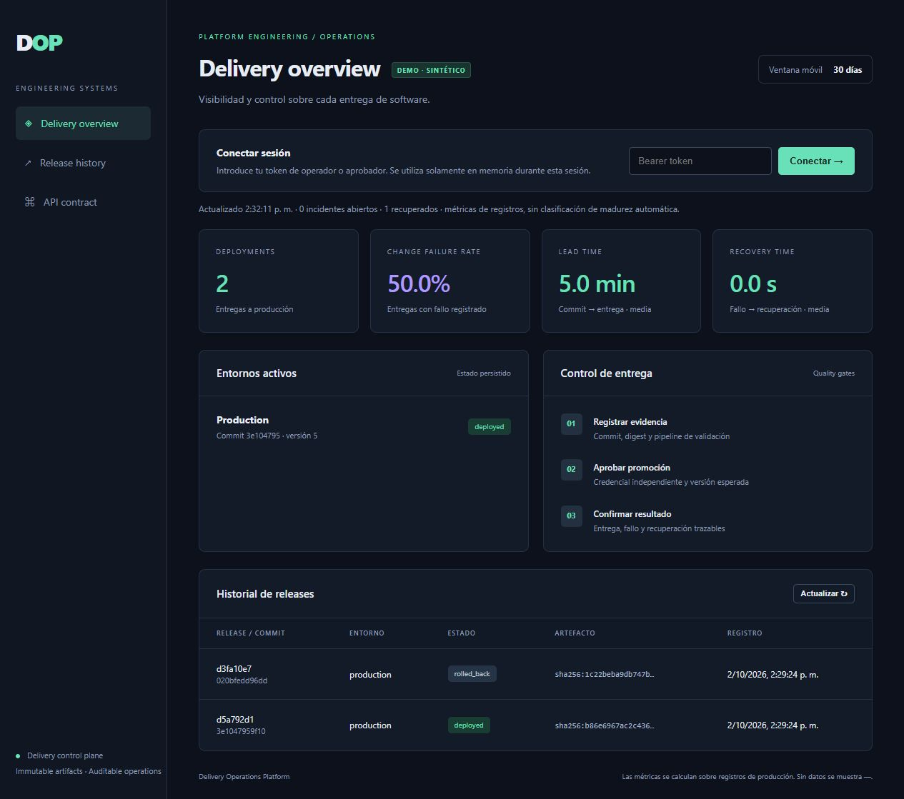
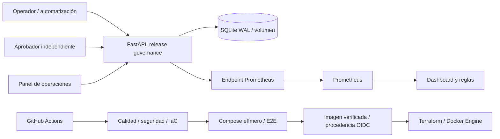

# Delivery Operations Platform

[](https://github.com/jorgefprietol/delivery-operations-platform/actions/workflows/ci.yml)

Plataforma de ingeniería para gestionar evidencia de entregas, aprobación de promociones, recuperación y visibilidad operativa. Desarrollada con **Python, FastAPI, SQLite, Docker, Terraform, GitHub Actions, Prometheus y Grafana**.

El proyecto implementa un control de releases con artefactos inmutables y métricas calculadas desde su historial. Su propio pipeline construye, despliega en un entorno efímero, verifica y publica una imagen OCI pública en GHCR con procedencia verificable.



## Capacidades

- Registro de commit y digest SHA-256, aprobación condicionada a Actions exitoso y procedencia firmada verificada con Sigstore; separación de credenciales entre operación y aprobación.
- Máquina de estados transaccional, conflictos por versión obsoleta y un único release activo por entorno.
- Recuperación al predecesor saludable y recuperación mediante una entrega de reemplazo.
- Historial persistente de eventos y reinicio sin pérdida de releases, almacenado en un volumen Docker.
- Panel web de operación, métricas HTTP con cardinalidad acotada, seis paneles Grafana y tres reglas de alerta provisionados desde código.
- Imágenes y herramientas fijadas por digest, dependencias con hashes, pruebas con cobertura mínima del 85%, análisis de vulnerabilidades y SBOM.
- Infraestructura local reproducible en Compose y un módulo Terraform para desplegar la API desde un digest publicado.

## Arquitectura



Las acciones `deploy` y `rollback` de la API **registran resultados** de una entrega ejecutada por un sistema externo: no controlan Docker ni acceden a hosts. Antes de aprobar, el modo predeterminado `verified` consulta el run real y verifica firma, certificado, transparencia e identidad del workflow, commit, intento y digest. Los checks declarados por el cliente no bastan para aprobar. `demo` permite escenarios sintéticos y deja ese hecho explícito en el recibo y el panel. [Decisiones y límites](docs/architecture.md).

## Ejecutar

Requisitos: Docker con contenedores Linux, Docker Compose y Python 3.12.

```powershell
git clone https://github.com/jorgefprietol/delivery-operations-platform.git
cd delivery-operations-platform
python scripts/init-env.py
docker compose up -d --build --wait --wait-timeout 240
```

| Componente | Dirección local |
| --- | --- |
| Panel y API | http://127.0.0.1:18095 |
| Contrato OpenAPI | http://127.0.0.1:18095/openapi.json |
| Prometheus | http://127.0.0.1:19095 |
| Grafana | http://127.0.0.1:13095 |

Para conectar el panel, usar `OPERATOR_TOKEN` o `APPROVER_TOKEN` del archivo `.env`. Grafana utiliza `admin` y `GRAFANA_PASSWORD`. Las credenciales se generan aleatoriamente, no se imprimen y no se incluyen en Git. Los servicios se publican únicamente en loopback.

## Verificar

```powershell
python -m venv .venv
.\.venv\Scripts\python -m pip install --require-hashes -r requirements-dev.lock
.\.venv\Scripts\python -m ruff check .
.\.venv\Scripts\python -m ruff format --check .
.\.venv\Scripts\python -m pytest
# Para escenarios sintéticos: configurar EVIDENCE_MODE=demo en .env y recrear la API.
docker compose up -d --no-build --wait
.\.venv\Scripts\python scripts/e2e.py --prometheus-url http://127.0.0.1:19095
.\.venv\Scripts\python scripts/check-monitoring.py
docker compose restart api
.\.venv\Scripts\python scripts/check-persistence.py
```

E2E crea registros **sintéticos** de dos entregas, un fallo y un rollback. Comprueba las restricciones de acceso, la máquina de estados, el historial y las métricas. Las pruebas de integración consultan Prometheus y Grafana reales. Las evidencias se guardan en `artifacts/`.

## Entrega automatizada

El workflow ejecuta calidad en Linux y Windows, valida Terraform y alertas, escanea secretos, construye la imagen una vez y levanta el stack completo. Tras las verificaciones HTTP, monitoreo y persistencia, bloquea vulnerabilidades HIGH/CRITICAL con corrección disponible en la imagen propia y genera SBOM CycloneDX.

En `main`, publica **la misma imagen probada** en `ghcr.io/jorgefprietol/delivery-operations-platform`, con tags `sha-<commit>` y `main`, y genera una atestación de procedencia con OIDC. Los PR no publican imágenes. El despliegue permanente en otro entorno requiere ejecutar Compose o Terraform; el pipeline entrega el artefacto y valida un despliegue efímero.

Después de que CI complete, el workflow **Verify published release evidence** valida una aprobación real con el run terminado y el digest publicado, usando la firma Sigstore. Esto evita que una URL plausible o booleans falsificados permitan una promoción.

```powershell
gh attestation verify oci://ghcr.io/jorgefprietol/delivery-operations-platform@sha256:<digest> -R jorgefprietol/delivery-operations-platform
# Establecer APP_IMAGE=ghcr.io/jorgefprietol/delivery-operations-platform@sha256:<digest> en .env
docker compose up -d --no-build --wait
```

## Documentación

- [Arquitectura y decisiones](docs/architecture.md)
- [Contrato y ejemplo de operación](docs/api.md)
- [Runbook, recuperación y Terraform](docs/operations.md)
- [Métricas y mejora continua](docs/metrics.md)
- [Experiencia de ingeniería](docs/engineering-experience.md)
- [Verificación](docs/verification.md)

Licencia MIT. Autor: Jorge Prieto.
