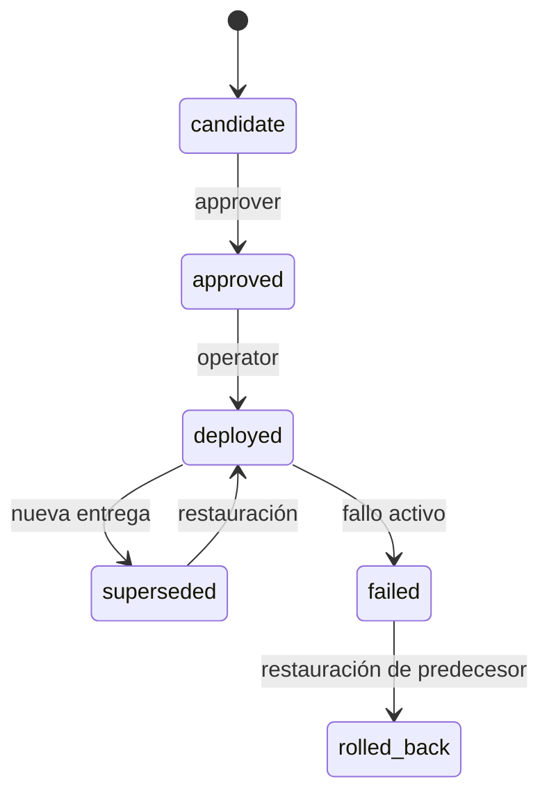

# Arquitectura y decisiones

## Problema y alcance

Un equipo necesita relacionar cada entrega con su commit, su artefacto y su evidencia; separar la aprobación de la ejecución y mantener un historial consultable de fallos y recuperación. La plataforma implementa ese registro y automatiza su propia entrega como contenedor.

La API es un control de registros. Un integrador debe ejecutar el despliegue real, comprobar su resultado y confirmar la transición. La autorización usa dos credenciales compartidas por rol; no equivale a identidad individual, SSO o atribución personal. Una evolución para múltiples equipos requiere identidad federada y evidencia firmada verificada en el servidor.

## Estado y concurrencia

Una entrega nueva puede recuperar un release fallido sin marcarlo como rollback: conserva el estado `failed` y registra `recovered_at`. Nunca utiliza una entrega fallida como predecesor saludable. No permite rollback de la primera entrega; requiere un reemplazo validado.

SQLite usa WAL y transacciones `BEGIN IMMEDIATE`: cada transición actualiza el release, el puntero activo y los eventos como una unidad. `expected_version` evita decisiones sobre versiones obsoletas. Una restricción única sobre entorno y digest impide registrar el mismo artefacto dos veces en el mismo entorno; staging y production están aislados.

Se utiliza un proceso Uvicorn y una base SQLite local para operación individual. El volumen requiere backup; no se proporciona replicación ni alta disponibilidad. Una implementación de varios nodos necesita almacenamiento compartido transaccional, por ejemplo PostgreSQL, y una estrategia de migraciones.

## Seguridad y operación

- Contenedor de aplicación sin privilegios, UID 10001, sistema de archivos de solo lectura, volumen de datos y capabilities eliminadas.
- Readiness comprueba acceso a la tabla de releases; liveness comprueba respuesta HTTP.
- Tokens distintos, mínimo 32 caracteres; comparación en tiempo constante. Se transmiten por bearer y se mantienen en memoria en el panel.
- Validación estricta de contrato, sentencias SQL parametrizadas, headers de seguridad y logs sin cuerpos ni tokens.
- Métricas y endpoints de salud quedan sin autenticación en la red interna/local; deben protegerse si se expone el servicio públicamente.
- La URL de evidencia y los checks declarados no son prueba criptográfica. Un operador autorizado puede declarar un resultado; ese modelo de confianza está explícito.
- El historial es append-only por la API, pero un administrador con acceso a SQLite puede modificarlo. No es almacenamiento inmutable ni un ledger firmado.

## Cadena de suministro

El pipeline utiliza Actions por SHA, imágenes por digest y locks Python con hashes. El job de publicación recibe el archivo de la imagen probada, sin recompilar. Solo ese job tiene permisos de escritura en packages y de atestación OIDC. El escaneo bloqueante cubre vulnerabilidades con corrección disponible en la imagen propia; Prometheus y Grafana deben actualizarse y evaluarse por separado en cada entorno.

Referencias: [procedencia verificable en GitHub](https://docs.github.com/en/actions/how-tos/secure-your-work/use-artifact-attestations/use-artifact-attestations), [cardinalidad de métricas Prometheus](https://prometheus.io/docs/practices/instrumentation/), [proveedor Docker para Terraform](https://registry.terraform.io/providers/kreuzwerker/docker/4.6.0/docs).
